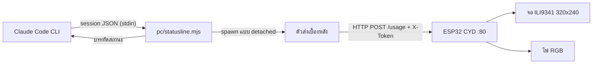

# ESP32-2432S028 (CYD) Claude Usage Monitor

จอ 2.8" ของบอร์ด ESP32-2432S028 (Cheap Yellow Display) แสดงการใช้งาน Claude แบบเดียวกับหน้า Usage

- **Current session** (ลิมิต 5 ชั่วโมง): % ที่ใช้ไปแบบตัวเลขใหญ่ + แถบสี + นับถอยหลังเวลารีเซ็ต
- **Weekly limit** (ลิมิต 7 วัน): % + แถบสี + นับถอยหลัง
- สีแถบ/ไฟ RGB บนบอร์ด: เขียว < 50% · เหลือง 50–79% · แดง ≥ 80%
- ท้ายจอบอกชื่อโมเดลและอัปเดตล่าสุดเมื่อไหร่ ถ้าเกิน 10 นาทีไม่มีข้อมูลใหม่จะขึ้น `STALE`
- กดปุ่ม **BOOT** เพื่อเปิด/ปิดไฟจอ

## หลักการทำงาน

Claude Code ส่งข้อมูล session (รวม `rate_limits`) ให้สคริปต์ status line ทุกครั้งที่ refresh
สคริปต์ `pc/statusline.mjs` แสดงผลบรรทัดสถานะใน terminal และยิงข้อมูลไปที่ ESP32 ผ่าน WiFi



- การส่งรันเป็น process แยก status line จึงไม่ต้องรอ network (ตอบกลับไม่เกิน 200ms แม้จอดับอยู่)
- ส่งเฉพาะเมื่อค่าเปลี่ยน หรือส่งซ้ำนาทีละครั้ง ถ้าส่งไม่ถึงจะเว้น 30 วินาทีก่อนลองใหม่
- ESP32 นับถอยหลังเองจากเวลาของ PC ที่แนบมากับข้อมูล จึงไม่ต้องใช้ NTP

## สิ่งที่ต้องมี

- บอร์ด ESP32-2432S028 (USB ช่องเดียว, ไดรเวอร์ ILI9341) ถ้าเป็นรุ่น 2 USB ให้แก้ `platformio.ini` เป็น `ST7789_DRIVER=1`
- PlatformIO (`pio`) และ Node.js 18 ขึ้นไป
- Claude Code แบบ CLI ล็อกอินด้วยบัญชี Claude Pro/Max (`rate_limits` มีเฉพาะบัญชี subscription และจะมาหลัง Claude ตอบข้อความแรกของ session)

## ติดตั้ง

### 1. ตั้งค่า WiFi และ token

`include/secrets.h` กับ `pc/config.json` (ทั้งสองไฟล์ไม่ขึ้น git) ต้องมี token ค่าเดียวกัน
ถ้ายังไม่มี ให้ copy จากไฟล์ `.example` แล้วแก้ค่า

```c
// include/secrets.h
#define WIFI_SSID "ชื่อ WiFi"      // ESP32 รองรับเฉพาะ 2.4 GHz
#define WIFI_PASS "รหัส WiFi"
#define API_TOKEN "สุ่มข้อความยาวๆ"
```

### 2. แฟลชเฟิร์มแวร์

```powershell
pio run -t upload; pio device monitor
```

เมื่อต่อ WiFi ได้ IP จะแสดงที่มุมขวาบนของจอ

### 3. ตั้งค่า PC

แก้ `pc/config.json`:

```json
{ "host": "http://192.168.1.50", "token": "ค่าเดียวกับ API_TOKEN" }
```

> แนะนำให้ใส่ IP ตรงๆ ใช้ `http://claude-usage.local` (mDNS) ได้ แต่บน Windows บางเครื่องหาไม่เจอ
> ถ้าเป็นไปได้ให้จอง IP ของบอร์ดใน router ไว้ (DHCP reservation)

ทดสอบด้วยข้อมูลจำลอง (จอควรขึ้น 42% / 67%):

```powershell
node pc/statusline.mjs --test
```

### 4. ผูกกับ Claude Code

เพิ่มใน `~/.claude/settings.json`:

```json
"statusLine": {
  "type": "command",
  "command": "node C:/path/to/esp32-cyd-claude-usage/pc/statusline.mjs"
}
```

(เปลี่ยน `C:/path/to` เป็นตำแหน่งที่ clone โปรเจ็กต์ไว้)

เปิด `claude` ใน terminal แล้วส่งข้อความหนึ่งครั้ง จอจะอัปเดต

## API ของบอร์ด

| Method | Path     | รายละเอียด                                                |
| ------ | -------- | --------------------------------------------------------- |
| `POST` | `/usage` | header `X-Token` ต้องตรงกับ `API_TOKEN` · body ดูด้านล่าง |
| `GET`  | `/`      | ค่าที่จอแสดงอยู่ตอนนี้ (JSON) ไว้เช็กสถานะ                |

```json
{
  "session": { "pct": 23.5, "resets_at": 1795775320 },
  "weekly": { "pct": 61, "resets_at": 1795970320 },
  "model": "Opus 5.5",
  "now": 1795770320
}
```

`resets_at` และ `now` เป็น Unix time (วินาที) ค่าที่ไม่รู้ส่งเป็น `null`

## โครงสร้างไฟล์

| ไฟล์                | หน้าที่                                            |
| ------------------- | -------------------------------------------------- |
| `platformio.ini`    | ตั้งค่าบอร์ด + ขาจอ TFT_eSPI + ไลบรารี             |
| `include/config.h`  | พอร์ต, ชื่อ mDNS, เวลา stale, เกณฑ์สี              |
| `include/strings.h` | ข้อความทั้งหมดบนจอ (ฟอนต์จอรองรับ ASCII เท่านั้น)  |
| `include/secrets.h` | WiFi + token (ไม่ขึ้น git)                         |
| `src/main.cpp`      | WiFi, web server, วาดจอ                            |
| `pc/statusline.mjs` | สคริปต์ status line ของ Claude Code + ตัวส่งข้อมูล |
| `pc/config.json`    | ที่อยู่บอร์ด + token (ไม่ขึ้น git)                 |

## แก้ปัญหา

| อาการ                             | สาเหตุ / วิธีแก้                                                                                    |
| --------------------------------- | --------------------------------------------------------------------------------------------------- |
| จอขึ้น `WiFi failed` แล้วรีสตาร์ต | ชื่อ/รหัส WiFi ผิด หรือเป็นคลื่น 5 GHz                                                              |
| status line ขึ้น `CYD offline`    | IP ใน `pc/config.json` ผิด, บอร์ดดับ หรือ PC กับบอร์ดอยู่คนละวง network                             |
| `--test` ได้ `HTTP 401`           | token ใน `config.json` ไม่ตรงกับ `secrets.h`                                                        |
| จอค้าง `Waiting for data`         | ยังไม่ได้ตั้ง `statusLine` หรือยังไม่มี `rate_limits` (บัญชีไม่ใช่ Pro/Max หรือยังไม่ได้ส่งข้อความ) |
| สีจอเพี้ยน/จอขาว                  | บอร์ดรุ่น 2 USB ใช้ `ST7789_DRIVER=1`                                                               |
